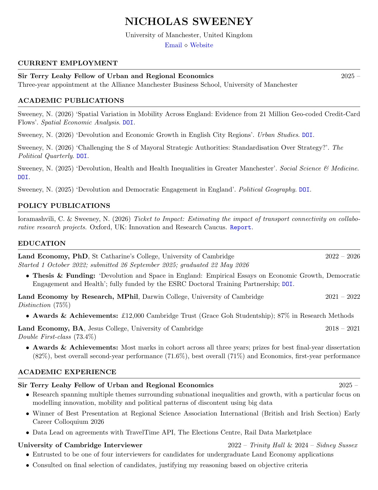
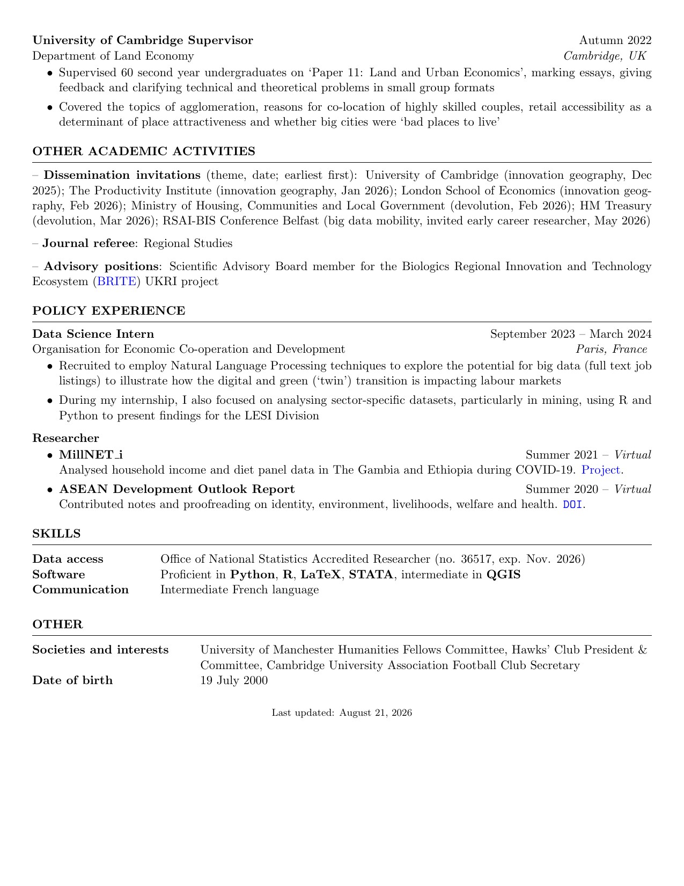

<p class="cv-lede">
  View my CV below, or
  <a class="cv-inline" href="../assets/cv.pdf" target="_blank" rel="noreferrer">open in a new tab</a>,
  or
  <a class="cv-inline" href="../assets/cv.pdf" download>download the PDF</a>
  for printing/sharing.
</p>

```{=html}
<div class="cv-box">
  <!-- Desktop/laptop: keep <object> (works well in Chrome/Firefox) -->
  <object data="../assets/cv.pdf" type="application/pdf" class="cv-embed cv-embed--object">
    <p class="cv-fallback">
      Your browser can’t display the PDF inline.
      <a class="cv-inline" href="../assets/cv.pdf" target="_blank" rel="noreferrer">Open the CV PDF</a>.
    </p>
  </object>

  <div class="cv-pages" role="region" aria-label="CV pages">
    <a href="../assets/cv.pdf" target="_blank" rel="noreferrer" aria-label="Open accessible CV PDF">
      
      
    </a>
  </div>
</div>
```

<style>
/* Keep Quarto header spacing reasonable */
.quarto-title-block{
  padding-top: .8rem !important;
  padding-bottom: .3rem !important;
  margin-bottom: .5rem !important;
}

/* Page container */
.cv-box{
  width: min(900px, 100%);
  margin-left: auto;
  margin-right: auto;
}

/* PDF box */
.cv-box{
  border-radius: 0;
  overflow: hidden;
  border: 0;
  background: #2b2b2b;
  box-shadow: none;
}

/* Shared embed styling */
.cv-embed{
  width: 100%;
  height: calc(100vh - 8.5rem);
  min-height: 720px;
  border: 0 !important;
  display: block;
  background: #2b2b2b;
}

/* Default: show the object (desktop) */
.cv-pages{ display: none; }

/* Mobile pages scroll with the document instead of a nested PDF viewer. */
@media (max-width: 750px){
  .cv-embed--object{ display: none; }
  .cv-box{ overflow: visible; background: transparent; }
  .cv-pages{ display: block; }
  .cv-pages a{ display: block; }
  .cv-pages img{
    display: block;
    width: 100%;
    height: auto;
    margin-bottom: 1rem;
    background: white;
  }
}

/* Fallback text */
.cv-fallback{
  padding: 1rem;
  margin: 0;
  color: rgba(31,41,55,.75);
}
</style>
